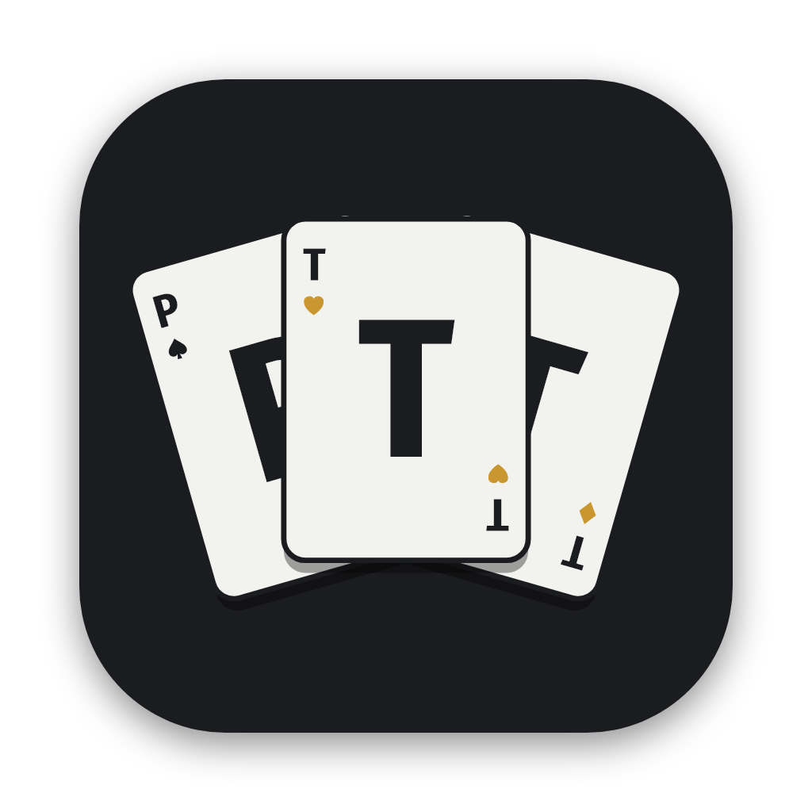
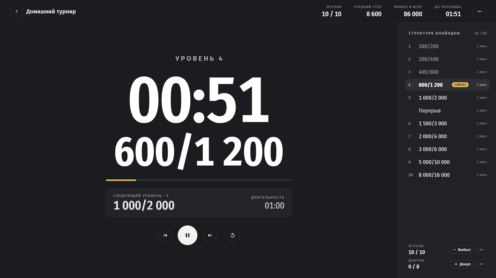
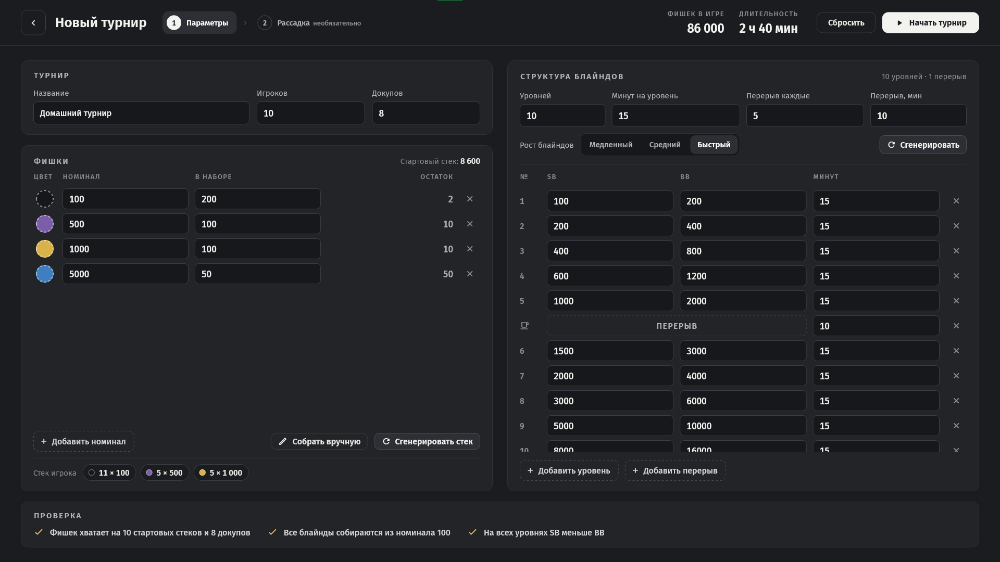
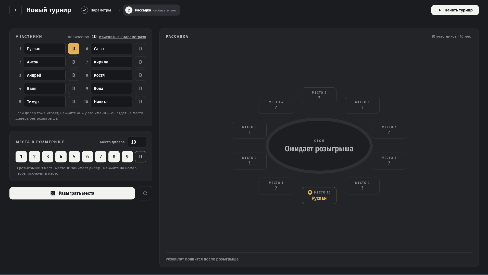
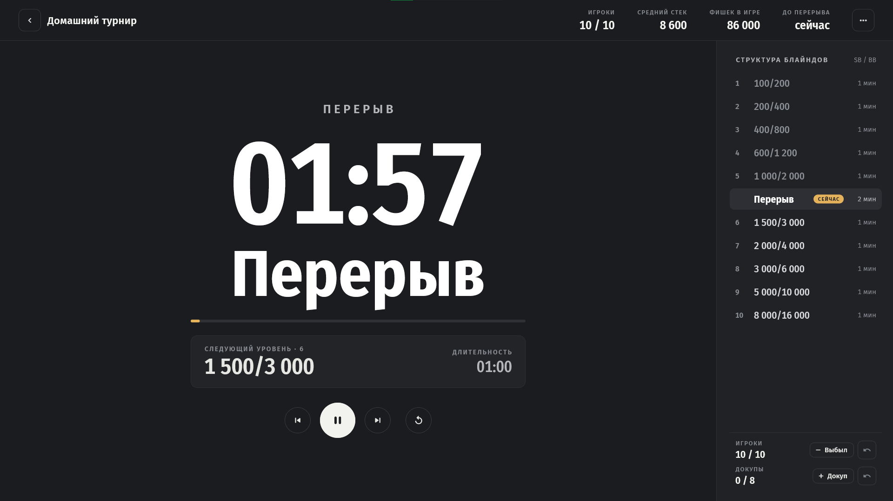
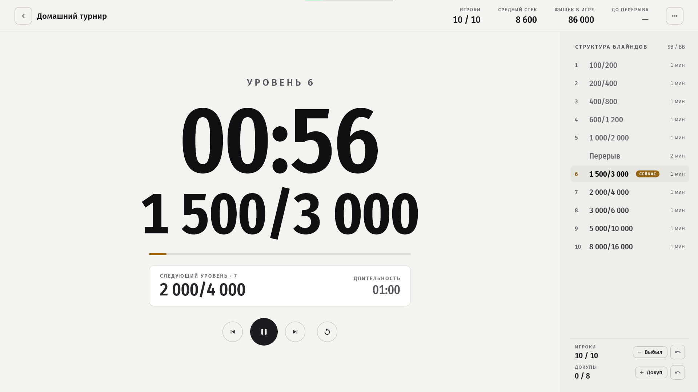

<div align="center">



# Poker Tournament Timer

**Десктопное приложение для домашних покерных турниров: таймер уровней, блайнды, фишки и честная рассадка за столом.**

Windows · macOS · русский / English

[Скачать последнюю версию](../../releases/latest)



</div>

> Исходный код закрыт. В этом репозитории — описание, скриншоты и готовые сборки.
> Доступ к коду — по запросу.

---

## Что умеет

### Настройка турнира
- **Игроки и докупы:** до 10 игроков за одним столом, резерв фишек на докупы.
- **Стартовый стек собирается из реального набора фишек.** Нужно указать номиналы и сколько фишек каждого номинала в коробке. Приложение поровну разделит их на все стеки или даст собрать стек вручную и покажет остаток.
- **Генератор структуры блайндов:** число уровней, длительность, перерывы, скорость роста (медленная / средняя / быстрая). Результат можно поправить в таблице.
- **Проверка на лету:** нельзя начать турнир, если фишек не хватает, блайнды не кратны минимальному номиналу или SB ≥ BB. Поля с ошибками подсвечиваются.
- Набор фишек запоминается: новый турнир сразу начинается с ваших номиналов и стека.



### Рассадка
- Розыгрыш мест за столом на 10 мест: перемешивание Фишера–Йетса на криптостойком генераторе, у каждого игрока равные шансы на любое место.
- Можно задать место дилера, исключить места, а дилер может играть сам.
- Результат показывается на овальном столе и списком «место → имя».



### Таймер
- Крупные цифры и высокий контраст: таймер и блайнды видно с другого конца стола. Раскладка подстраивается под размер окна.
- Старт, пауза, переход к предыдущему или следующему уровню, перезапуск уровня, горячие клавиши.
- Перерывы, следующий уровень, время до перерыва, средний стек, учёт выбывших и докупов.
- Звуковой сигнал смены уровня и предупреждение за минуту до конца уровня.
- Турнир сохраняется и продолжается после перезапуска приложения.

<p>
  
  
</p>

### Настройки
Тёмная, светлая или системная тема (переключается на лету), русский и английский язык, громкость, полноэкранный режим, запрет выключения экрана.

---

## Технологии

| | |
|---|---|
| **Платформа** | Flutter (Dart 3), десктоп: Windows, macOS |
| **Архитектура** | Clean Architecture + feature-first: `domain` (чистый Dart) ← `data`, `presentation` |
| **Состояние** | `flutter_bloc` (Bloc / Cubit), неизменяемые состояния на `equatable` |
| **DI** | `get_it`; репозитории подключаются через интерфейсы |
| **Навигация** | `go_router` |
| **Локализация** | `flutter_localizations` + `intl`, ARB с ICU-плюралами (ru, en) |
| **Хранение** | `shared_preferences` |
| **Тесты** | ~740 unit- и widget-тестов: `flutter_test`, `bloc_test`, `fake_async` |

### Инженерные решения
- **Время без дрейфа.** Таймер не полагается на `Timer.periodic`. Состояние хранит момент старта и остаток, а оставшееся время считается от инжектируемого `Clock`. Поэтому таймер не отстаёт за долгий турнир, а тесты «проматывают» уровни мгновенно.
- **Тестируемая случайность.** В приложении рассадка работает на `Random.secure()`, в тестах — на `Random(seed)`, поэтому результат детерминирован.
- **Строгие границы фич.** Фича может импортировать только `domain/` другой фичи. Общий UI-кит вынесен в `core/widgets/`, по одному виджету на файл.
- **Дизайн-система в коде.** Цвета задаются через `ThemeExtension`, текстовые стили и отступы — токенами из макета. Хардкода цветов и размеров в виджетах нет. Шрифты Fira Sans встроены, поэтому приложение работает офлайн и с кириллицей.
- **Процесс.** Задачи ведутся в GitHub Issues, изменения вносятся через Pull Request в ветку `dev` с обязательными `flutter analyze` и `flutter test`. Коммиты — по Conventional Commits, версии — по SemVer с CHANGELOG.

### Структура

```
lib/
  app/          # MaterialApp.router, DI, маршруты
  core/         # тема, локализация, UI-кит, утилиты (Clock, форматирование)
  features/
    home/  tournament/  tournament_setup/  seating/  timer/  app_settings/
      domain/        # сущности, интерфейсы репозиториев, use case'ы
      data/          # модели, источники данных, реализации репозиториев
      presentation/  # Bloc'и, экраны, виджеты
```

---

## Установка

Загрузите архив для своей ОС из [Releases](../../releases/latest).

- **Windows:** распакуйте архив и запустите `poker_tournament_timer.exe`.
- **macOS:** откройте `.dmg` и перетащите приложение в «Программы». При первом запуске: правый клик → «Открыть», потому что приложение не подписано.

## Версии

- **1.1.1** — новый турнир наследует только набор фишек, исправлен порядок списка рассадки.
- **1.1.0** — играющий дилер в рассадке, не больше 10 игроков за столом.
- **1.0.0** — первая версия: настройка, рассадка, таймер, настройки.
